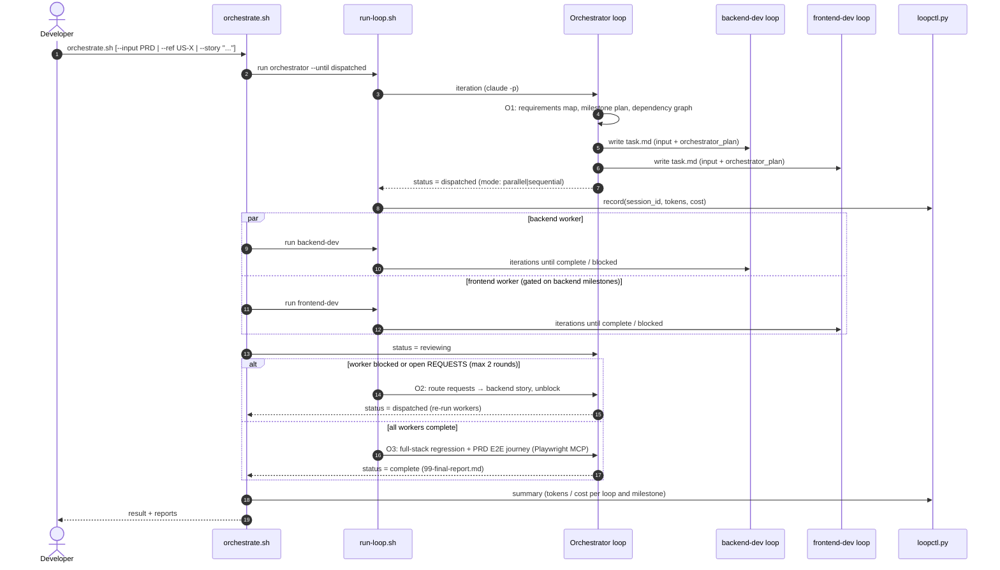
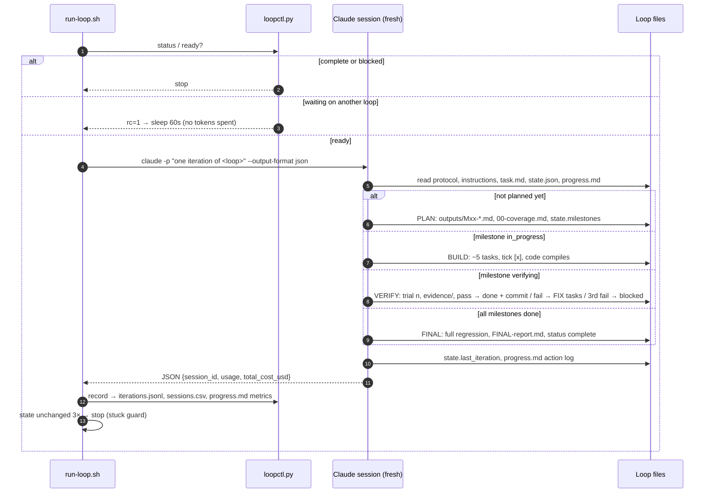
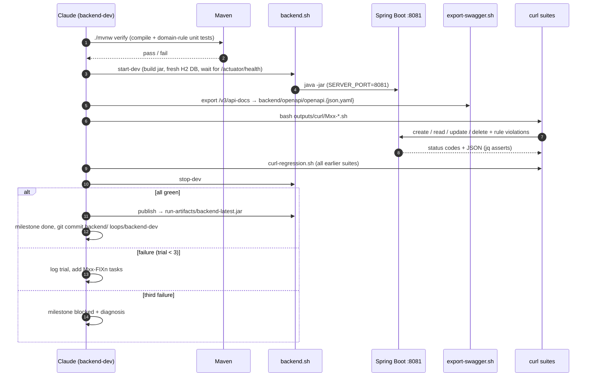
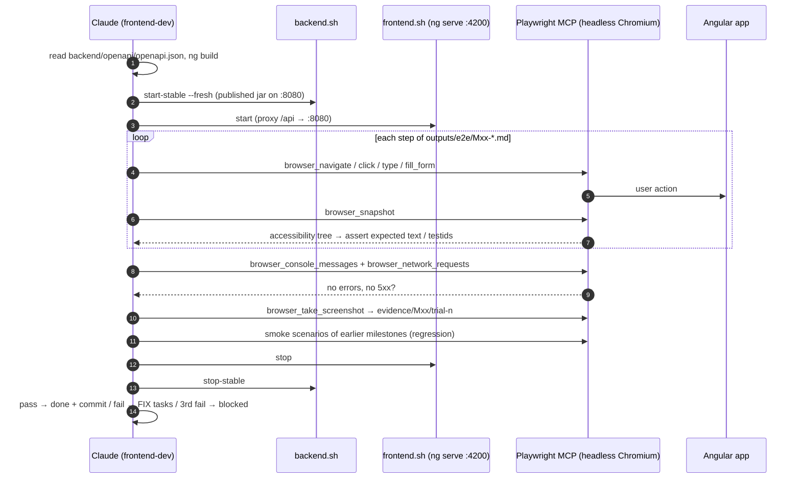
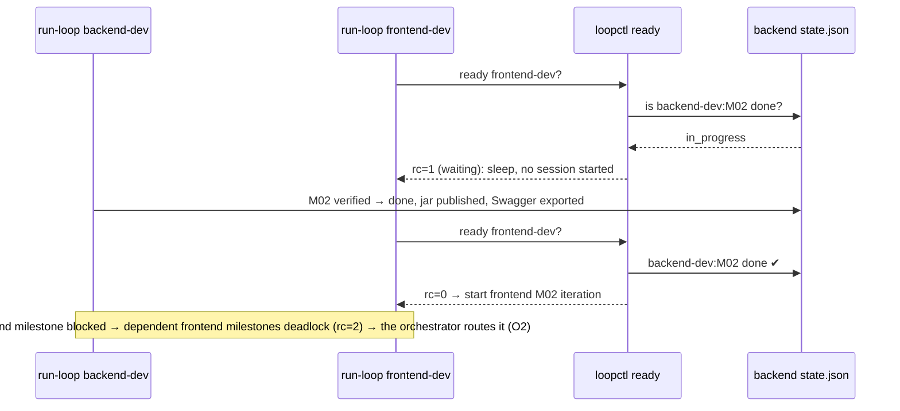

# QuickFlow: built with reusable Claude Loops

QuickFlow (tasks, habits, learning resources, time-boxed plans, dashboard) is implemented by **reusable Claude Loops**.
Each loop is a folder of instructions and state that a fresh headless Claude session runs one iteration at a time until the loop's milestone work is verified or its trial budget runs out.

The loops are **project-agnostic**: give them any PRD (full project) or a single user story, through the orchestrator or directly.

| Loop | Input | Output | Verification |
|---|---|---|---|
| `orchestrator` | PRD or one user story | requirements map, cross-loop milestone plan, dependency graph, final report | Full-stack Playwright journey + backend regression |
| `backend-dev` | PRD / story (+ orchestrator plan) | Spring Boot API, Swagger (`backend/openapi/`), phase files | `./mvnw verify` + curl suites per phase |
| `frontend-dev` | PRD / story + backend Swagger | Angular app at `http://localhost:4200`, phase files | Playwright MCP scenarios per phase |

---

## Repository layout
```
requirements/          PRD.md · DECISIONS.md (settles PRD ambiguities) · task-brief.txt
loops/
  _shared/             LOOP_PROTOCOL.md (the iteration contract) · stack-profiles/ · templates/
  orchestrator/        Loop-instructions.md · task.md · progress.md · state/ · outputs/
  backend-dev/         Loop-instructions.md · task.md · progress.md · state/ · outputs/ (Mxx-*.md, curl/, evidence/)
  frontend-dev/        Loop-instructions.md · task.md · progress.md · state/ · outputs/ (Mxx-*.md, e2e/, evidence/)
scripts/               run-loop.sh · orchestrate.sh · loopctl.py · backend.sh · frontend.sh · export-swagger.sh · curl-regression.sh · setup.sh
backend/  frontend/    generated by the loops
run-artifacts/         sessions.csv (every session: prompt, id, tokens, cost) · logs/ · playwright/ · prompts-and-sessions.xlsx
```

Every loop has the structure the brief requires:

| Item | Where | Notes |
|---|---|---|
| Loop instructions | `Loop-instructions.md` | Loop-specific. The shared contract is in `_shared/LOOP_PROTOCOL.md` |
| Task | `task.md` | A YAML input block: `type: prd | user_story`, path, scope, ref/text, options |
| Progress | `progress.md` | Milestone metrics (start, end, iterations, trials, tokens, cost, session IDs), generated automatically, plus the agent's action log |
| State | `state/state.json` (agent) + `state/iterations.jsonl` (runner) | Status, milestones, dependencies, trials |
| Stop condition | protocol §4 | Milestone verified green, **or 3 failed trials → blocked** |
| Outputs | `outputs/` | One md file per milestone (spec → design → tasks with checkboxes → acceptance checks → trials) |

## Design decisions
1. **One iteration = one fresh session.** Context never builds up. All memory lives in files, and each iteration reads the files and adds to them. This keeps long builds cheap and reproducible.
2. **Bash owns control flow, the agent owns content.** The runner decides when to start, wait and stop, and records **session ID, tokens and cost** from `claude -p --output-format json`. The agent never has to estimate its own usage.
3. **Milestones are vertical slices with objective acceptance checks.** Backend: executable curl suites (`outputs/curl/Mxx-*.sh`) that assert status codes and JSON. Frontend: Playwright MCP scenarios with `data-testid` selectors, screenshots, and console/5xx checks. Earlier milestones are regression-tested on every trial.
4. **3-trial budget per milestone.** Failed trials add root-cause fix tasks. A third failure blocks the milestone with a written diagnosis, and independent milestones continue.
5. **Swagger is the contract.** The backend exports `backend/openapi/openapi.json` after every milestone. The frontend builds only from it, and gaps go to `outputs/REQUESTS.md`, which the orchestrator routes back to the backend loop.
6. **Parallel with dependency gating.** Frontend milestones declare `depends_on: backend-dev:Mxx`. `loopctl.py ready` checks this without spending tokens. The backend verifies on :8081 and publishes a stable jar that the frontend tests against on :8080, so the two loops never stop each other's servers.
7. **Ambiguity is settled before the run** (`requirements/DECISIONS.md`). During a run, loops record assumptions instead of stopping to ask.

---

## Sequence diagrams

### 1. Orchestrated run (full PRD or single story)


### 2. One iteration (shared by every loop)


### 3. backend-dev: milestone verification (one trial)


### 4. frontend-dev: milestone verification with Playwright MCP


### 5. Parallel mode: dependency gating across loops


---

## How to run

### One-time setup
```bash
scripts/setup.sh                 # checks the toolchain, installs Playwright Chromium, hints for openpyxl/git
git init && git add -A && git commit -m "Loops scaffold"   # loops commit after every milestone
```

### Full project through the orchestrator
```bash
scripts/orchestrate.sh                                  # PRD from loops/orchestrator/task.md
scripts/orchestrate.sh --mode sequential                # backend first, then frontend
```

### A single user story (incremental, reuses existing code)
```bash
scripts/orchestrate.sh --ref US-PLAN-07                           # a story already in the PRD
scripts/orchestrate.sh --story "As a user I want to tag tasks"    # a new story
```

### Use one loop directly (without the orchestrator)
```bash
scripts/run-loop.sh backend-dev                         # uses loops/backend-dev/task.md
scripts/run-loop.sh backend-dev --scope "Tasks, Habits"
scripts/run-loop.sh frontend-dev --ref US-TASK-05
```
Or inside an interactive Claude Code session: `/loop Run one iteration of the backend-dev loop per loops/_shared/LOOP_PROTOCOL.md`. Interactive runs are not token-logged by the runner, so record them in `run-artifacts/manual-prompts.csv`.

### Monitor and report
```bash
python3 scripts/loopctl.py summary                      # tokens / cost / time per milestone, all loops
cat loops/backend-dev/progress.md                       # metrics + action log
tail -f run-artifacts/logs/backend-dev/iter-*.stderr
pip install --user openpyxl && python3 scripts/loopctl.py excel   # → run-artifacts/prompts-and-sessions.xlsx
```

### Options (environment)
| Variable | Default | Meaning |
|---|---|---|
| `LOOP_PERMISSION_MODE` | `acceptEdits` | Bash permissions come from `.claude/settings.json` |
| `LOOP_SKIP_PERMISSIONS` | `0` | `1` = `--dangerously-skip-permissions` (only in a container / VM) |
| `LOOP_WAIT_SECONDS` / `LOOP_MAX_WAIT_MIN` | 60 / 240 | Dependency-wait polling interval and timeout |
| `LOOP_MAX_STUCK` | 3 | Stop after N iterations with no change to state |

## Reusing the loops for another project
1. Put the new PRD in `requirements/`, and write a fresh `DECISIONS.md` (or let O1 generate the "Assumed" entries).
2. Reset each loop: `state/state.json` → `status: not_started`, empty `milestones`. Empty `iterations.jsonl` and `outputs/`.
3. For a different stack, copy a file in `loops/_shared/stack-profiles/` and point `task.md` → `stack_profile` at it.
Nothing in `Loop-instructions.md` or `LOOP_PROTOCOL.md` is specific to QuickFlow.

## Machine notes
- Java 17 → Spring Boot 3.5. Node 18.20 → Angular 19, and the Playwright MCP is pinned to `0.0.40` (newer versions need Node ≥ 20).
- The Playwright MCP runs with `--no-sandbox` because Ubuntu 24.04's AppArmor blocks Chromium's user-namespace sandbox.
