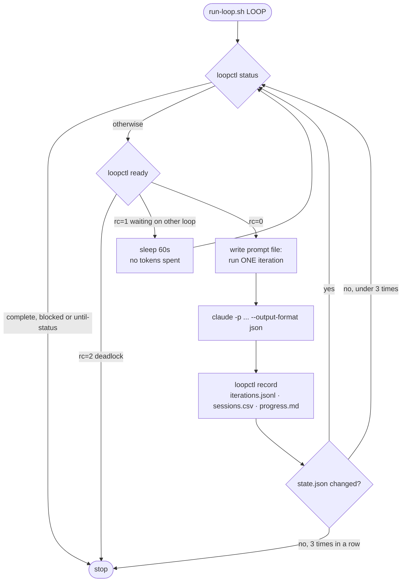
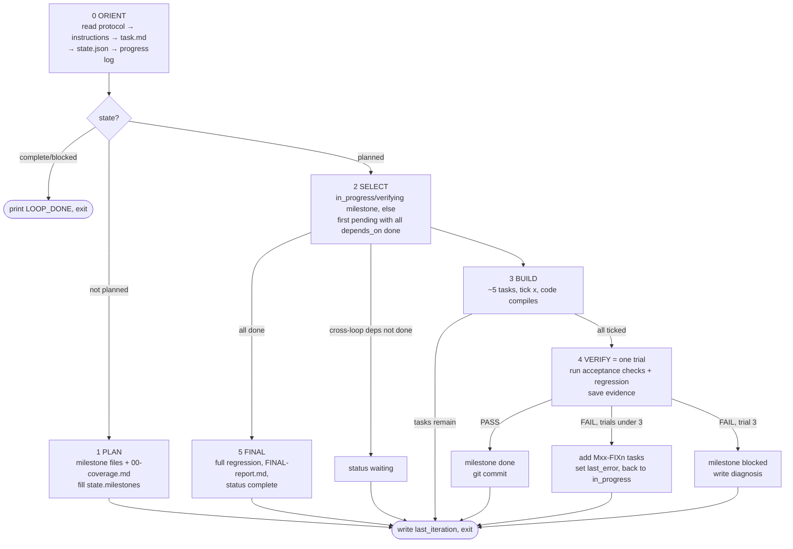
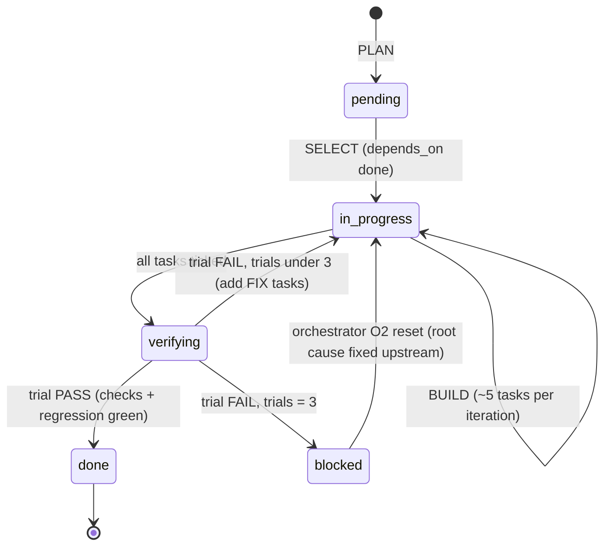
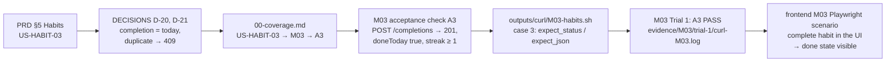
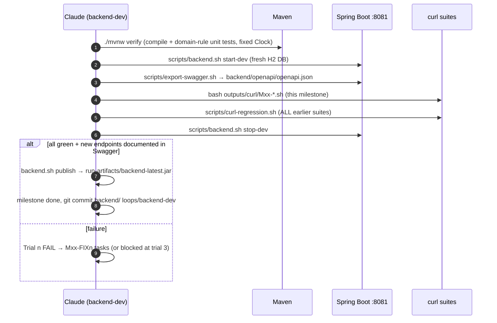
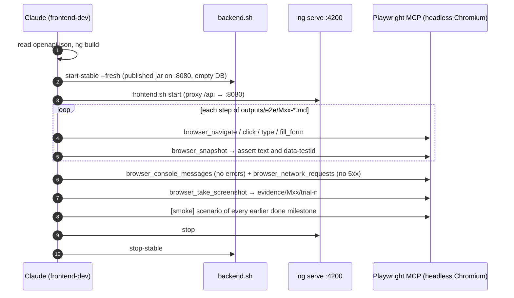
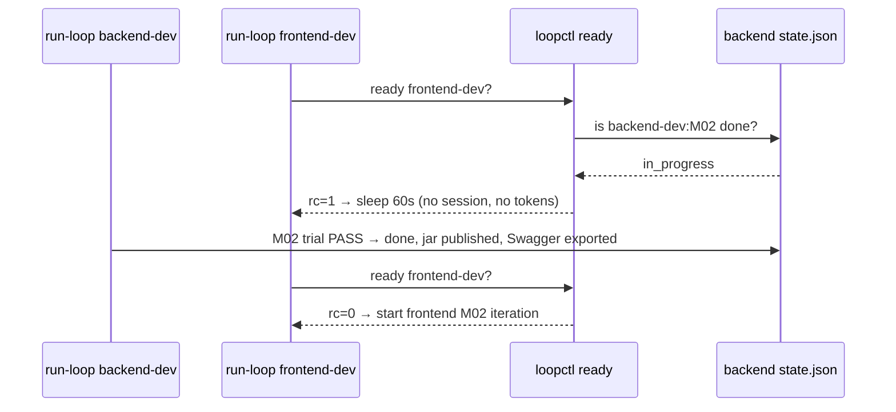
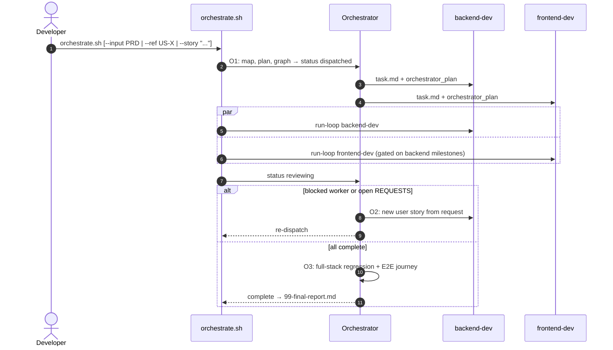

# Claude Loops: How QuickFlow Builds Itself

> Presentation notes. Each `---` section is one slide or talking point.
> Source files: `loops/_shared/LOOP_PROTOCOL.md`, `loops/*/Loop-instructions.md`, `scripts/run-loop.sh`, `scripts/loopctl.py`, `scripts/orchestrate.sh`.

---

## 1. The problem

The brief asked for:

- A **backend-dev loop**: PRD → phase files with task checkboxes → code → Swagger → a **curl** test after every phase.
- A **frontend-dev loop**: PRD + Swagger → phase files → UI → a **Playwright MCP** test after every feature.
- Loops that are **reusable for any application**, take a **full PRD or a single user story**, and run **through an orchestrator or directly**.
- A fixed structure for every loop: `Loop-instructions.md`, `task.md`, `progress.md` (start, end and tokens per milestone), `state/`, `outputs/`.
- A stop condition: **the milestone is complete, or 3 trials are used up.**

The product being built is **QuickFlow**, a single-user productivity app with Tasks, Habits, Learning Resources, Todo Plans (with live "rest time"), a Dashboard and Settings.

---

## 2. Three loops, one shared protocol

| Loop | Input | Output | Verification |
|---|---|---|---|
| `orchestrator` | PRD or one user story | Requirements map, cross-loop milestone plan, dependency graph, final report | Full-stack Playwright journey + backend regression |
| `backend-dev` | PRD / story (+ orchestrator plan) | Spring Boot API, `backend/openapi/openapi.json`, milestone files | `./mvnw verify` + curl suites |
| `frontend-dev` | PRD / story + backend Swagger | Angular app at `:4200`, milestone files | Playwright MCP scenarios |

How the pieces fit together, and why that makes the loops reusable:

| Layer | File | Changes when… |
|---|---|---|
| Protocol (generic) | `loops/_shared/LOOP_PROTOCOL.md` | Never: it's the same for every loop and every project |
| Role | `loops/<loop>/Loop-instructions.md` | The kind of work changes (backend, frontend, orchestration) |
| Technology | `loops/_shared/stack-profiles/*.md` | The stack changes (Spring Boot, Angular, …) |
| Project | `loops/<loop>/task.md` | The requirements change (PRD path, story, scope) |

---

## 3. Step zero: settle the requirements before the run

```
requirements/
  PRD.md          source of truth (stories, FR-xx, BR-n, UX, NFR, Definition of Done)
  DECISIONS.md    answers to everything the PRD leaves open
  task-brief.txt  the assignment
```

- An autonomous loop **can't stop to ask a question**, so the ambiguities are settled up front.
  - **D-12**: overdue = `dueDate < today` AND status ≠ DONE AND not archived.
  - **D-43**: a plan's status is a pure function of `now`, so it stays correct after a restart.
  - **D-45**: rest time counts down every 1 s, formatted `HH:MM:SS`.
- If a loop hits a **new** ambiguity, it picks the simplest option, appends an `A-xx` entry ("Assumed during loop runs") and **carries on**. The backend run added A-01 to A-10.
- **Deterministic story IDs**: `US-<AREA>-<NN>` in document order, such as `US-TASK-01` and `US-PLAN-07`. Every loop derives the same IDs, so coverage tables line up across loops.

---

## 4. What a loop is: just a folder

```
loops/<loop>/
  Loop-instructions.md    how THIS loop plans, builds, verifies (fixed during a run)
  task.md                 INPUT (YAML): type prd|user_story, path, scope, ref/text, options
  progress.md             METRICS table (runner) + Action Log (agent, append-only)
  state/state.json        agent's machine-readable memory: status, milestones, trials
  state/iterations.jsonl  runner's record of every session: id, tokens, cost
  outputs/                Mxx-*.md per milestone, test suites, evidence, reports
```

Example `task.md` input block:

```yaml
input:
  type: prd                 # prd | user_story
  path: requirements/PRD.md
  scope: ALL                # or "Tasks, Habits"
  ref: null                 # user_story: US-PLAN-03
  text: null                # user_story: the story text if it is new
stack_profile: loops/_shared/stack-profiles/backend-springboot.md
orchestrator_plan: null     # set by the orchestrator
priority_override: []       # human override of milestone order
```

---

## 5. Design choice 1: one iteration = one fresh session

- `scripts/run-loop.sh` starts a **new** `claude -p` session for every iteration.
- The session has **no memory**. It reads the files, does one unit of work, writes the files and exits.
- *"If you did not write it down, it did not happen."* (LOOP_PROTOCOL §1)

Why this works:

- Context never fills up, so iteration 40 costs about the same as iteration 2.
- A crash loses at most one iteration.
- Every decision is on disk, so the build can be audited.

---

## 6. Design choice 2: bash owns control flow, the agent owns content

| Runner (`run-loop.sh` + `loopctl.py`) | Agent (Claude session) |
|---|---|
| Decides when to start, wait and stop | Plans, writes code, runs the tests |
| Records session ID, tokens and cost from `--output-format json` | Updates `state.json` and the milestone files |
| Writes the METRICS table in `progress.md` | Appends rows to the Action Log |
| Checks cross-loop dependencies (**no tokens spent**) | Decides PASS or FAIL from the evidence |
| Stuck guard: stops if `state.json` doesn't change for 3 iterations | |

The agent never estimates its own usage. The numbers come straight from the CLI.

---

## 7. The runner loop



The prompt is tiny and the same every time:

> *You are running exactly ONE iteration of the 'backend-dev' loop. Read LOOP_PROTOCOL.md, then Loop-instructions.md, and follow them for one iteration only. Make sure state.json is valid JSON and last_iteration is filled in.*

All the intelligence is in the files the session reads.

---

## 8. Inside one iteration: the protocol algorithm



---

## 9. Milestone lifecycle and the 3-trial stop condition



Hard rules that keep this honest (LOOP_PROTOCOL §5):

- Never tick `[x]` without doing the task. Never mark `done` without a **green trial recorded in the milestone file**.
- **Never reset `trials`. Never weaken or delete an acceptance check to make it pass.** Only the orchestrator may reset trials, and only after the root cause is fixed upstream.
- Stay in scope: backend touches only `backend/`, frontend only `frontend/`. Cross-side needs go to `outputs/REQUESTS.md`.
- Stop every server you start (the `scripts/` helpers manage PID files).

---

## 10. The milestone file: requirements → checks → evidence

Every `outputs/Mxx-*.md` follows `loops/_shared/templates/milestone-template.md`:

1. **Header**: status, depends on, stories, requirements.
2. **Spec**: what is in scope and what is explicitly not.
3. **Design notes**: schema, rules, endpoints, response fields.
4. **Tasks**: `- [x] M03-T02 HabitRules (streak, progress %) + unit tests with fixed Clock`
5. **Acceptance checks**: each one names the requirement it proves.
6. **Verification trials**: PASS/FAIL per check, per trial, with evidence paths.
7. **Notes / Blocked**: files touched, hooks for later milestones, diagnosis.

**The checks are written at PLAN time, before any code.** A milestone is done only when every check passes in a recorded trial, so the requirements decide when the work is finished.

---

## 11. Tracing one requirement end to end

**US-HABIT-03**: *"As a user, I want to mark a habit complete for today."*



From the real curl suite:

```bash
req POST "/habits/$D/completions"
expect_status A3 "complete today 201" 201
req GET "/habits/$D"
expect_json   A3 "doneToday true"   '.doneToday' true
expect_json   A3 "streak >= 1"      '.currentStreak >= 1' true
```

Every assertion carries its check ID (`A3`), so a failure points straight back to the requirement.

---

## 12. backend-dev: how it plans and verifies

**Decomposition rules**: Foundation → one vertical slice per domain area (referenced entities first) → aggregates → Hardening.

QuickFlow plan: `M01 Foundation → M02 Tasks, M03 Habits, M04 Learning → M05 Plans core → M06 Plan items → M07 Dashboard + Settings → M08 Hardening`



- Time-based rules (overdue, streaks, plan status, remaining seconds) live in **pure `*Rules` classes** with unit tests on a fixed `Clock`.
- Responses carry computed fields (`overdue`, `progressPercent`, `remainingSeconds`, `serverTime`) so the frontend can build from Swagger alone.

---

## 13. frontend-dev: verification in a real browser

Each frontend milestone declares the backend milestone it needs, for example `M02 Tasks page → depends_on: M01, backend-dev:M02`.



Scenario format (written at PLAN time):

```markdown
## S1 [smoke] Create a task from the Tasks page
Proves: US-TASK-01, FR-01
| Step | Action | Expected |
|---|---|---|
| 1 | navigate {app_url}/tasks | h1 "Tasks" visible; empty-state-tasks visible |
| 2 | click task-add-btn; type task-form-title "E2E task {ts}"; click task-form-save | row visible |
```

- **Time-based features** (start notification, countdown): create data relative to now, then `browser_wait_for`, or check that the countdown changes between two snapshots.
- **If the backend is missing something, don't work around it**: write it in `outputs/REQUESTS.md`, and the orchestrator routes it back.

---

## 14. Running in parallel safely



- **Swagger is the contract.** It is re-exported after every backend milestone, and the frontend builds only from it.
- **Separate ports**: the backend verifies on `:8081`. After a PASS it **publishes** a jar, which the frontend runs on `:8080`. The two loops never stop each other's servers, and `publish` replaces the jar atomically.
- **Scoped commits**: each loop runs `git add` only on its own paths.
- **Deadlock detection**: if a backend milestone is blocked, the dependent frontend milestones return rc=2, and the orchestrator steps in.

---

## 15. The orchestrator: from PRD to workflow

It never writes app code. It plans, routes and integrates.

| Phase | What it produces / does |
|---|---|
| **O1 Analyze & plan** | `01-requirements-map.md` (every story, FR, BR, UX, NFR → layer → milestone → decision) · `02-milestone-plan.md` (authoritative list for both workers) · `03-dependency-graph.md` (Mermaid + parallel waves) · rewrites each worker's `task.md` with `orchestrator_plan` · chooses `parallel` or `sequential` |
| *workers run* | `orchestrate.sh` runs both `run-loop.sh` processes |
| **O2 Route & re-dispatch** (≤ 2 rounds) | Turns frontend `REQUESTS.md` items into backend user stories, resets blocked milestones once fixed upstream, re-dispatches |
| **O3 Integrate & verify** (≤ 3 trials) | Fresh full stack · curl regression against the stable jar · the PRD's full user journey in Playwright · Definition of Done check · `99-final-report.md` |



---

## 16. Full PRD or a single story

| Command | What happens |
|---|---|
| `scripts/orchestrate.sh` | Full PRD from `loops/orchestrator/task.md` |
| `scripts/orchestrate.sh --story "As a user I want tags on tasks"` | **Incremental**: plans only that story; workers add new milestones continuing the numbering (M09…), each with a regression of the existing suites |
| `scripts/orchestrate.sh --ref US-PLAN-07` | One existing PRD story |
| `scripts/run-loop.sh backend-dev` | Direct use of one worker, no orchestrator |
| `scripts/run-loop.sh frontend-dev --scope "Tasks"` | Direct use, limited scope |

A new input reopens a `complete` loop automatically: the runner sets it back to `in_progress`, and the agent runs PLAN for only the new scope.

---

## 17. Results of this run (as of 2026-10-10)

The two worker loops were started **directly**. The orchestrator was not used (its state is `not_started`).

**backend-dev: complete**

| Metric | Value |
|---|---|
| Milestones | 8 (M01–M08), **all passed on trial 1** |
| Iterations | 10 (plan + 8 build/verify + final), about 1 hour |
| Final regression | 8 curl suites / **606 checks** green on a fresh instance, **33 unit tests**, 41 documented endpoints |
| Tokens / cost | ~26.0M tokens (mostly cache reads) / **$16.46** |
| Assumptions recorded | A-01 to A-10 in `DECISIONS.md` |

Example of the loop adapting on its own: `priority_override` made M03 Habits run before M02 Tasks. That exposed a Flyway migration-ordering problem, which the loop resolved with `out-of-order: true` and recorded as **A-04**, without stopping.

**frontend-dev: in progress**

| Milestone | Status |
|---|---|
| PLANNING | done (9 milestones, M01–M09) |
| M01 App shell | done: trial 1, build green, 8/8 steps ✅, no console errors, no 5xx (4 iterations, $2.44) |
| M02 Tasks page | partly built, not yet verified |
| M03–M09 | pending |

All sessions (prompt, session ID, tokens, cost) are in `run-artifacts/sessions.csv`. `python3 scripts/loopctl.py excel` builds `run-artifacts/prompts-and-sessions.xlsx` from it.

---

## 18. Summary

```
PRD + DECISIONS
  → (orchestrator) requirements map + cross-loop milestone plan + dependency graph
  → each loop PLANs milestones whose acceptance checks name requirement IDs
  → fresh session per iteration: BUILD ~5 tasks → VERIFY trial (curl / Playwright + regression + evidence)
      PASS → commit (+ publish jar)   FAIL → FIX tasks   3rd FAIL → blocked with diagnosis
  → FINAL coverage report per loop
  → orchestrator O3: full-stack journey against the PRD's Definition of Done
```

**Key ideas**

1. Files are the memory, and every session starts fresh.
2. Bash controls the flow; Claude does the work.
3. Acceptance checks are written before code and tied to requirement IDs.
4. Three trials, no weakening of checks, a written diagnosis on failure.
5. Swagger is the contract, and dependency gating costs no tokens.
6. Generic protocol + role + stack profile + task input = reusable for any project.
